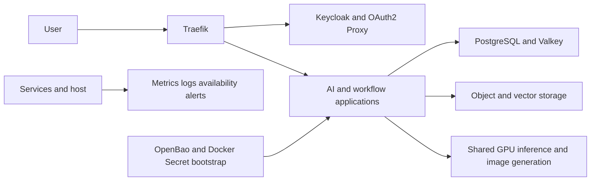

# Home and Development Host Architecture

<!-- document-core: WORKSPACE-DOCUMENT-CORE/1.0.0 -->

## 문서 개요

### 목적과 독자

Readers use the architecture-description payload below for this document's information and judgments.

### 책임과 적용 범위

The frontmatter and role payload own the maintained subject, owner and applicability.

## 내용 계약

### 입력과 전제

Actual inputs and preconditions are those declared by the role payload below.

### 본문과 규칙

#### Context and Boundaries

##### System Boundary

The root Compose owns include, and the service profile owns activation. The
canonical owner of the vocabulary is
[POL-0078](../../05.operations/02.policies/01.common/0078-compose-profile-vocabulary.md).
Distinguish the current host, which holds operational data, from a separate
Compose project for experiments. Profiles are not a security isolation
boundary and share the same Docker daemon failure. The shared Compose network
is an existing implementation's trust boundary, and this design does not
prove complete network isolation.

Storage and Redis administration packages are flat under `04-data`; processing, data quality, BI, dbt and JupyterLab are standalone LAB entrypoints under `labs/` (SPEC-0262). Software verification and development mail capture belong to `11-quality`; platform tools remain in `09-platform-ops`. Dozzle belongs to Observability; Open Notebook/SurrealDB and MLflow belong to AI. This is source organization only and does
not change HOME selection or the root Compose project (ADR-0062).

###### Purpose and Readers
<!-- core-payload-level:4 -->

One Linux server shares HOME service and development experiments. The user
also designated AI and workflow as always-on HOME capabilities. The goal is
to keep the service within the scope where one operator can explain state
and the recovery path. An optional capability with no confirmed real
consumer does not push its always-on startup cost onto HOME.

###### Context
<!-- core-payload-level:4 -->

The operator and development experiments share one Linux server. Traefik fronts the HOME services, external Project-Template-derived workspaces register through the project-registration contract, and the Mermaid diagram in the Runtime View shows the user, gateway, identity, application, state, object, GPU and observability flows.

##### Constraints

Profiles are not a security isolation boundary and share the same Docker daemon failure, and the shared Compose network is an existing trust boundary, not proven isolation. Root Compose never includes external application source, no secret values belong in diagrams or evidence, and runtime pins come from Compose and Dockerfile declarations.

#### Structure

##### Building Blocks

| Class | Retained capability | Activation and limitation |
| --- | --- | --- |
| HOME | Traefik, Keycloak, OAuth2 Proxy, OpenBao | `core`; OpenBao bootstrap readiness required |
| HOME | Management PostgreSQL/Valkey and exporters | `mng`; service metadata, sessions and management queues |
| HOME | Ollama and Qdrant | `ai`, `ai-llm`; shared GPU concurrency is bounded |
| Optional root | ComfyUI | `ai-image`; shared GPU concurrency is bounded, and standalone LAB placement remains planned |
| HOME | Airflow and n8n, workers and runners | `workflow`; initialization and daemon readiness differ |
| HOME | Single-node object storage | `storage`; no single-host HA claim |
| HOME | Metrics, host/GPU signals, availability, logs, alerts, tracing and profiling | narrow observability profiles from POL-0078 |
| DEV | Single TimescaleDB Community PostgreSQL and Valkey | `dev-data`; project database/roles and ACL prefixes are separately approved |
| DEV | Mail capture and explicit update/IaC jobs | jobs run only for a named operation |
| OPTIONAL | Additional application databases and analytics | enable only for a known consumer |
| LAB | Open WebUI, a standalone LAB with profile `lab-open-webui` under `labs/open-webui/` | outside the root project; not a HOME service |
| LAB | Standalone projects under `labs/<name>/`: multi-node database, broker and storage variants, analytics and quality tools | outside the root project; rehearsal topology, not physical fault isolation; none promoted |
| MIGRATE | superseded tooling awaiting acceptance | preserve data and references until migration acceptance |

Traefik remains the shared gateway. Development time-series workloads use
TimescaleDB Community on the single development PostgreSQL; its TSL terms
are distinct from PostgreSQL licensing. Management PostgreSQL does not gain
Timescale without an existing consumer requirement. Projects use explicit
database/role and Valkey ACL contracts rather than expanding legacy `app_db`.
Shared Prometheus, Grafana, SeaweedFS and Qdrant remain the common services;
k6 supplies load tests, WireMock HTTP mocks, and Locust optional isolated LABs.

External Project-Template-derived workspaces own business API/UI, migrations,
adapters, workflows, fixtures, E2E and application Compose. Infrastructure
owns engines, shared ingress/identity, observability, backup and bounded
resource registration. Root Compose never includes external application source.
The [registration contract](../../../infra/09-platform-ops/project-registration/README.md)
and [development database policy](../../05.operations/02.policies/05.databases-and-storage/0100-development-database.md)
own the current interfaces; metadata approval does not deploy or issue secrets.
The independent 07/08 product-planning tracks grant no runtime resource authority.

##### Interfaces

| Interface | Producer | Consumer | Contract | Failure |
| --- | --- | --- | --- | --- |
| Project registration for external workspaces | Infrastructure (`infra/09-platform-ops/project-registration`) | External Project-Template-derived workspaces | [registration contract](../../../infra/09-platform-ops/project-registration/README.md) | The description records no failure handling for this interface. |
| Development database and Valkey ACL | DEV TimescaleDB Community PostgreSQL and Valkey (`dev-data`) | Projects | [development database policy](../../05.operations/02.policies/05.databases-and-storage/0100-development-database.md) | The description records no failure handling for this interface. |
| Shared gateway ingress | Traefik | User (Runtime View diagram) | The description links no contract for this interface. | The description records no failure handling for this interface. |
| Secret delivery | OpenBao rendered outputs and Docker Secret bootstrap | AI and workflow applications | The description links no contract for this interface. | The description records no failure handling for this interface. |
| Compose profile selection | Root Compose and service profiles | The description names no consumer for this interface. | [POL-0078](../../05.operations/02.policies/01.common/0078-compose-profile-vocabulary.md) | The description records no failure handling for this interface. |

- The [registration contract](../../../infra/09-platform-ops/project-registration/README.md) and [development database policy](../../05.operations/02.policies/05.databases-and-storage/0100-development-database.md) own the current interfaces for external workspaces.
- Projects use explicit database/role and Valkey ACL contracts rather than the legacy `app_db`.
- [POL-0078](../../05.operations/02.policies/01.common/0078-compose-profile-vocabulary.md) owns the profile vocabulary.

#### Runtime Behavior

##### Normal Flow

###### Runtime View
<!-- core-payload-level:4 -->

OpenBao rendered outputs and Docker Secret consumers are distinct existing paths;
a migration must verify consumer mounts and permissions before claiming automatic
rotation or complete secret delivery. No secret values belong in diagrams or evidence.

###### Deployment View
<!-- core-payload-level:4 -->

The source-controlled selection is validated before deployment. `core mng ai
workflow storage obs-core obs-host availability logs alerting tracing profiling
obs-gpu registry` describes the
current HOME candidate; it is not a new competing profile vocabulary or approval.
Use exact services for approved incremental deployment. Exclude cluster variants,
legacy selectors and update/IaC jobs from unattended startup.

Runtime pins come from Compose and Dockerfile declarations. The version registry
is a derived Compose image projection; source inventory separately inspects
Dockerfile build sources. Documents route to the applicable source or projection
instead of repeating patch pins without context.
Renovate is the sole dependency updater: it owns the enabled infrastructure managers and
npm for Storybook and the OpsflowSmtp node. Dependabot version updates are retired.

##### Failure and Recovery

Single-host power, storage, Docker daemon and GPU failure affect multiple HOME
capabilities. Git configuration rollback cannot undo database migrations.
Unattended startup excludes cluster variants, legacy selectors and update/IaC
jobs. Deployment requires isolated backup and restore evidence for the affected
data. The dated [MLflow recovery receipt](../../03.specs/0212-request-baseline-and-reconciliation/01.tasks/tsk-0008-infra-audit-execution.md#c19-row-resolutions-2026-10-28 "navigation")
covers the named MLflow target on 2026-10-28.

#### Quality Scenarios

##### Scenarios

###### Quality Attributes
<!-- core-payload-level:4 -->

- Availability: initialization completion, daemon health and application readiness
  are separate evidence. Unseal and authenticated functional checks are explicit.
- Capacity: retain HOME application availability while limiting simultaneous GPU
  jobs. Container memory caps do not prove workload fit or prevent host contention.
- Recoverability: keep protected backups and prove restoration on isolated data;
  Git configuration rollback cannot undo database migrations.
- Maintainability: README routes to implementation; Guide, Policy and Runbook
  have separate ownership, with current commands in Runbooks.
- Security: prefer authenticated gateway ingress and loopback diagnostic ports;
  document remaining host publications and shared network grants as residual risk.

###### Risks
<!-- core-payload-level:4 -->

Single-host power, storage, Docker daemon and GPU failure affect multiple HOME
capabilities. Existing shared networks and host-level capabilities limit isolation.
Current backup/restore, OpenBao bootstrap and resource acceptance are not yet
proven by this redesign. Keep these as deployment prerequisites, not PASS claims.

##### Trade-offs

- HOME service and development experiments share one Linux server, so
  single-host power, storage, Docker daemon and GPU failure affect multiple
  HOME capabilities (Purpose and Readers, Risks).
- Profiles select activation but are not a security isolation boundary; the
  shared Compose network remains an existing trust boundary, not proven
  isolation (System Boundary, Constraints).
- HOME application availability is retained by limiting simultaneous GPU
  jobs; container memory caps do not prove workload fit or prevent host
  contention (Quality Attributes).
- An optional capability with no confirmed real consumer does not push its
  always-on startup cost onto HOME (Purpose and Readers).
- Single-node object storage makes no single-host HA claim, and Git
  configuration rollback cannot undo database migrations (Building Blocks,
  Failure and Recovery).
- Remaining host publications and shared network grants are documented as
  residual risk (Quality Attributes).

#### Decisions and Adoption

##### Decisions

- [ADR-0062](../02.decisions/0062-home-lab-membership.md)

##### Adoption Boundaries

###### Requirement Mapping
<!-- core-payload-level:4 -->

- [REQ-0027](../../01.requirements/0027-home-development-host.md)
- [SPEC-0262 Analytics LAB migration](../../03.specs/0262-analytics-labs-migration/spec.md)

###### Currentness and Lineage
<!-- core-payload-level:4 -->

- SPEC-0180 and SPEC-0265 (retired; version history; ADR-0060 holds the Hermes report source contract)
- [Service disposition research](../../90.references/01.research/0002-agentic-engineering-research-pack/m0021-local-docker-service-consolidation.md)
- [Infrastructure implementation](../../../infra/README.md)

###### Evolution
<!-- core-payload-level:4 -->

Measure actual application usage and restore evidence before removing persistent
services or changing storage engines. Promote only validated optional capabilities;
retire migrations through the summarize-and-delete retirement contract, never
by rewriting history or deleting unverified data.

## 적용과 확인

### 적용 방법

Use the procedures or reading order stated in the role payload.

### 확인 기준

Apply only this document's stated checks and limits; execution, verification and acceptance remain separate.

## 관계와 출처

### 관련 문서

The role payload retains the current owner and dependency references.

### 외부 근거

External basis and its limits remain those stated in the role payload; a citation grants no authority.
