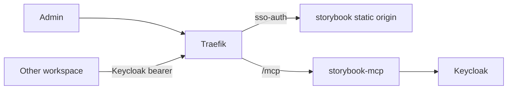

# Experience Tier Architecture Description

<!-- document-core: WORKSPACE-DOCUMENT-CORE/1.0.0 -->

## 문서 개요

### 목적과 독자

Readers use the architecture-description payload below for this document's information and judgments.

### 책임과 적용 범위

The frontmatter and role payload own the maintained subject, owner and applicability.

## 내용 계약

### 입력과 전제

Actual inputs and preconditions are those declared by the role payload below.

### 본문과 규칙

#### Context and Boundaries

##### System Boundary

- **storybook:** an unprivileged, read-only static origin on the internal
  `experience_ingress_net`, with no secret, persistent volume or host port.
  Traefik serves `storybook.${DEFAULT_URL}` behind `req-rate-limit`,
  `gateway-standard-chain` and `sso-auth`.
- **storybook-mcp:** a read-only remote docs MCP on `edge_net` that serves the
  manifests of the same build. It accepts only Keycloak bearer tokens for its
  own URL from the `/admins` group; Traefik forwards only `/mcp` and the
  protected-resource metadata path, and no cookie-based `sso-auth` applies.
- **Selection:** both services use the `experience` profile and carry the
  `hy-home.tier: experience` label.
- **Non-goals:** component code, stories and the static build belong to
  `projects/storybook/nextjs`; this tier owns no business application, and
  Compose validation proves no running service, login or HOME activation.

###### Purpose and Readers
<!-- core-payload-level:4 -->

The `13-experience` tier owns the shared Storybook delivery: a static
documentation origin and a remote docs MCP, both built from one commit of
`projects/storybook/nextjs`. Stakeholders are UI developers, design reviewers
and infrastructure operators. The tier is optional and outside the default HOME
selection.

###### Context
<!-- core-payload-level:4 -->

UI developers and design reviewers reach Storybook through Traefik with `sso-auth`, while other workspaces call `storybook-mcp` with a Keycloak bearer token. The tier depends on Keycloak and the `projects/storybook/nextjs` build.

##### Constraints

The tier is optional and outside the default HOME selection. Both images are pinned to one commit, the static origin serves only administrators, the MCP authorizes by token alone, and static validation infers no runtime, TLS or browser result.

#### Structure

##### Building Blocks

##### Interfaces

| Interface | Producer | Consumer | Contract | Failure |
| --- | --- | --- | --- | --- |
| `storybook.${DEFAULT_URL}` static origin | `storybook` on `experience_ingress_net` | Administrators through Traefik | `req-rate-limit`, `gateway-standard-chain` and `sso-auth`; [Storybook policy](../../05.operations/02.policies/14.design-system/0101-storybook.md) | Both images use `pull_policy: never`, so a missing image fails the start. |
| `storybook-mcp` `/mcp` and protected-resource metadata path | `storybook-mcp` on `edge_net` | Other workspaces with Keycloak bearer tokens from the `/admins` group | [Storybook policy](../../05.operations/02.policies/14.design-system/0101-storybook.md) | The MCP rejects a token with the wrong signature, issuer, audience, lifetime or group. |
| Keycloak token verification | Keycloak | `storybook-mcp` | The description links no contract for this interface. | The description records no failure handling for this interface. |

- `storybook.${DEFAULT_URL}` is served through `req-rate-limit`, `gateway-standard-chain` and `sso-auth`.
- `storybook-mcp` serves `docs-list`, `docs-show` and `docs-show-story` on `/mcp` and the protected-resource metadata path, for Keycloak bearer tokens from the `/admins` group.
- Both services use the `experience` profile.

#### Runtime Behavior

##### Normal Flow

###### Runtime View
<!-- core-payload-level:4 -->

Administrators reach the static origin after the gateway and ForwardAuth
checks. Other workspaces call `storybook-mcp` with a Keycloak token; the server
verifies the signature, issuer, audience, lifetime and group before it returns
`docs-list`, `docs-show` or `docs-show-story` results.

###### Deployment View
<!-- core-payload-level:4 -->

The root Compose project includes the `infra/13-experience/storybook` leaf.
Both images are pinned to the same commit with `pull_policy: never`, so a
missing image fails the start. The `experience` profile is selected only on
request.

##### Failure and Recovery

Both images use `pull_policy: never`, so a missing image fails the start. The MCP rejects a token with the wrong signature, issuer, audience, lifetime or group, and no cookie-based `sso-auth` applies to the MCP.

#### Quality Scenarios

##### Scenarios

###### Quality Attributes
<!-- core-payload-level:4 -->

Delivery is reproducible from one commit. The static origin serves content only
to administrators, and the MCP authorizes by token alone. Static validation
infers no runtime, TLS or browser result.

###### Risks
<!-- core-payload-level:4 -->

A build whose commit differs between the two images, or a token accepted for
another audience, would break the contracts that POL-0101 defines.

##### Trade-offs

- Both images are pinned to one commit with `pull_policy: never`, which makes
  delivery reproducible but means a missing image fails the start (Deployment
  View, Failure and Recovery).
- The MCP authorizes by token alone, without cookie-based `sso-auth`; a token
  accepted for another audience would break the POL-0101 contracts (Quality
  Attributes, Risks).
- The tier is optional and outside the default HOME selection, and static
  validation infers no runtime, TLS or browser result (Constraints).

#### Decisions and Adoption

##### Decisions

No ADR is linked to this description. POL-0101 and its operations documents, linked under Currentness and Lineage, define the contracts.

##### Adoption Boundaries

###### Requirement Mapping
<!-- core-payload-level:4 -->

- [REQ-0027](../../01.requirements/0027-home-development-host.md)

###### Currentness and Lineage
<!-- core-payload-level:4 -->

- SPEC-0219 (retired; version history)
- [Storybook guide](../../05.operations/01.guides/14.design-system/0101-storybook.md)
- [Storybook policy](../../05.operations/02.policies/14.design-system/0101-storybook.md)
- [Storybook runbook](../../05.operations/03.runbooks/14.design-system/0101-storybook.md)
- [Experience tier packages](../../../infra/13-experience/README.md)
- [AD-0031](0031-home-development-host.md)

###### Evolution
<!-- core-payload-level:4 -->

Changes to the build, routes or token checks follow POL-0101 and its
operations documents; this description changes only when the structure does.

## 적용과 확인

### 적용 방법

Use the procedures or reading order stated in the role payload.

### 확인 기준

Apply only this document's stated checks and limits; execution, verification and acceptance remain separate.

## 관계와 출처

### 관련 문서

The role payload retains the current owner and dependency references.

### 외부 근거

External basis and its limits remain those stated in the role payload; a citation grants no authority.
