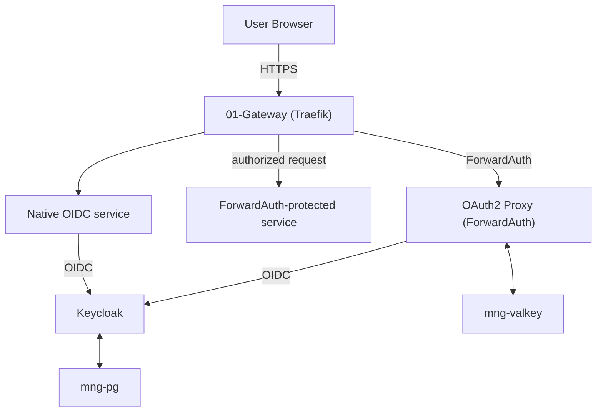

# 02-Auth Architecture Description

## Overview

`02-auth` centers on Keycloak, the central identity provider, and OAuth2 Proxy,
the gateway authentication layer. Services with their own OIDC and RBAC connect
to Keycloak directly; services without it use OAuth2 Proxy ForwardAuth. The
principles are one identity source (Keycloak), OIDC as the protocol, selective
enforcement per service, no ForwardAuth in front of a native-OIDC service by
default, fail-closed access, and file-based secrets. Stakeholders are the
platform, DevOps and security owners.

## Scope

- **Owns:** the Keycloak identity boundary, the choice between ForwardAuth and
  native OIDC, the OAuth2 Proxy session boundary, and the OIDC issuer and
  redirect trust.
- **Consumes:** `01-gateway` HTTPS routing; `04-data` `mng-pg` and
  `mng-valkey`.
- **Does not own:** per-application RBAC (Airflow and Kafbat roles, OpenBao
  policy stay with each application), non-authentication logic, secret values,
  and execution evidence.
- **Non-goals:** a new identity provider, a fail-open default, and one
  middleware for every service.

AD-0014, the former auth hardening description, is retired into this document;
its hardening substance is owned by ADR-0017.

## Structure

### Architecture



- **ForwardAuth** (`gateway-standard-chain@file,sso-errors@file,sso-auth@file`):
  Flower, n8n, Prometheus, Loki, Tempo, Alloy, Alertmanager, Pushgateway,
  Pyroscope, cAdvisor, Qdrant, RedisInsight, ComfyUI, Ollama, MLflow, Schema
  Registry, Kafka Connect, Kafka REST, Terrakube and the Mailpit UI.
- **Native OIDC** (`gateway-standard-chain@file` only, application performs
  OIDC with Keycloak): Airflow (`KeycloakAuthManager` with Authorization
  Services), Kafbat UI, Open WebUI, Grafana, Gatus and OpenBao. Dozzle also uses
  native OIDC behind an admin IP allow list.

OpenBao maps the Keycloak group `/openbao-admins` to its OIDC role
`home-admin`, which issues a token under the `hy-home-operator` policy.
Keycloak groups and OpenBao roles and policies are separate objects.

## Runtime and Deployment

### Runtime View

```text
ForwardAuth:  Browser -> Traefik -> /oauth2/auth check -> Traefik -> service
              (login when needed: Browser <-> OAuth2 Proxy <-> Keycloak; session cookie)
Native OIDC:  Browser -> Traefik -> application -> Keycloak
```

Keycloak realm, user and session metadata are stored in `mng-pg`; OAuth2 Proxy
sessions in `mng-valkey`. Compose-injected client, cookie, database and JWT
secrets are read from `/run/secrets`. The OpenBao OIDC client secret lives in
the OpenBao auth backend and is not in Compose files or documents.

### Deployment View

`keycloak` (`infra/02-auth/keycloak/`) and `oauth2-proxy`
(`infra/02-auth/oauth2-proxy/`) are selected by `core`, `auth`, `dev` and
`local`. The `dedicated-valkey` profile adds `oauth2-proxy-valkey` and its
exporter.

## Quality and Risks

### Quality Attributes

- **Performance:** ForwardAuth uses the lightweight `/oauth2/auth` check.
- **Security:** native-OIDC applications do not receive injected
  `Authorization` headers.
- **Reliability:** Keycloak, Valkey and PostgreSQL health are checked
  separately from each application's login flow.
- **Observability:** failures must be attributable to Keycloak, OAuth2 Proxy
  or the application from their logs.

### Risks

Keycloak and `mng-pg` are single instances; an outage blocks every login path.
A route that loses its middleware label is exposed without ForwardAuth.

### Evolution

Moving a service between patterns follows ADR-0038 and the application
authentication guide.

## Related Documents

- [REQ-0002 Auth requirements](../../01.requirements/0002-auth.md)
- [ADR-0002 Keycloak and OAuth2 Proxy choice](../decisions/0002-keycloak-oauth2-proxy-choice.md)
- [ADR-0017 Runtime hardening and fail-closed](../decisions/0017-auth-hardening-runtime-and-fail-closed.md)
- [ADR-0038 Selective Native OIDC](../decisions/0038-selective-native-oidc-for-native-auth-apps.md)
- [Keycloak guide](../../05.operations/guides/03-identity-and-access/0014-keycloak.md)
- [OAuth2 Proxy guide](../../05.operations/guides/03-identity-and-access/0015-oauth2-proxy.md)
- [Application authentication integration](../../05.operations/guides/03-identity-and-access/0079-application-auth-integration.md)
- [Derived Compose image projection](../../../infra/tech-stack.versions.json)
