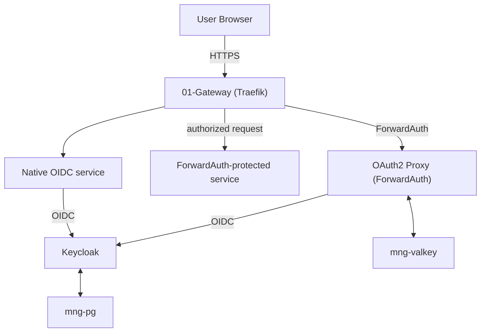

# 02-Auth Architecture Description

## Context and Boundaries

### System Boundary

- **Owns:** the Keycloak identity boundary, the choice between ForwardAuth and
  native OIDC, the OAuth2 Proxy session boundary, and the OIDC issuer and
  redirect trust.
- **Consumes:** `01-gateway` HTTPS routing; `04-data` `mng-pg` and
  `mng-valkey`.
- **Does not own:** per-application RBAC (Airflow and Kafbat roles, OpenBao
  policy stay with each application), non-authentication logic, secret values,
  and execution evidence.
- **Non-goals:** a new identity provider, a fail-open default, and one
  middleware for every service.

AD-0014, the former auth hardening description, is retired into this document;
its hardening substance is owned by ADR-0017.

#### Purpose and Readers

`02-auth` centers on Keycloak, the central identity provider, and OAuth2 Proxy,
the gateway authentication layer. Services with their own OIDC and RBAC connect
to Keycloak directly; services without it use OAuth2 Proxy ForwardAuth. The
principles are one identity source (Keycloak), OIDC as the protocol, selective
enforcement per service, no ForwardAuth in front of a native-OIDC service by
default, fail-closed access, and file-based secrets. Stakeholders are the
platform, DevOps and security owners.

#### Context

Browsers reach HOME's Keycloak-backed services through `01-gateway` (Traefik).
Keycloak stores state in `mng-pg` and OAuth2 Proxy sessions live in
`mng-valkey` (`04-data`), as the diagram under Building Blocks shows.
The standalone Open WebUI LAB reaches Keycloak through its configured issuer
and has its own browser entrypoint.

### Constraints

Access is fail-closed with one identity source (Keycloak), OIDC as the protocol, and file-based secrets read from `/run/secrets`. No ForwardAuth sits in front of a native-OIDC service by default, and a fail-open default is a non-goal.

## Structure

### Building Blocks



- **ForwardAuth** (`gateway-standard-chain@file,sso-errors@file,sso-auth@file`):
  Flower, Prometheus, Loki, Tempo, Alloy, Alertmanager, Pushgateway,
  Pyroscope, cAdvisor, Qdrant, RedisInsight, ComfyUI, Ollama, MLflow,
  Terrakube and the Mailpit UI. Some routes add an allowlist.
- **HOME native OIDC** (`gateway-standard-chain@file` only, application performs
  OIDC with Keycloak): Airflow (`KeycloakAuthManager` with Authorization
  Services), Kafbat UI, Grafana, Gatus and OpenBao. Dozzle also uses
  native OIDC behind an admin IP allow list.
- **Application login:** n8n uses the gateway standard chain and its own login.
- **Standalone LAB:** Open WebUI uses native Keycloak OIDC with no Traefik
  route. Schema Registry and Kafka Connect have LAB-internal HTTP endpoints
  without HOME ForwardAuth.

OpenBao maps the Keycloak group `/openbao-admins` to its OIDC role
`home-admin`, which issues a token under the `hy-home-operator` policy.
Keycloak groups and OpenBao roles and policies are separate objects.

### Interfaces

| Interface | Producer | Consumer | Contract | Failure |
| --- | --- | --- | --- | --- |
| ForwardAuth `/oauth2/auth` check | OAuth2 Proxy | Traefik (`01-gateway`) for ForwardAuth-protected services | `gateway-standard-chain@file,sso-errors@file,sso-auth@file` | Access is fail-closed; a route that loses its middleware label loses that gateway protection. |
| OIDC to Keycloak | Keycloak | OAuth2 Proxy and native-OIDC applications (Airflow, Kafbat UI, Grafana, Gatus, OpenBao, Dozzle, Open WebUI) | OIDC; [ADR-0038 Selective Native OIDC](../decisions/0038-selective-native-oidc-for-native-auth-apps.md) | A Keycloak outage blocks new logins that depend on Keycloak; health is checked separately from each application's login flow. |
| OpenBao OIDC role mapping | Keycloak group `/openbao-admins` | OpenBao OIDC role `home-admin` | Token under the `hy-home-operator` policy | The description records no failure handling for this interface. |
| HTTPS routing | `01-gateway` (Traefik) | `02-auth` services | `gateway-standard-chain@file` | The description records no failure handling for this interface. |
| Keycloak state store | `mng-pg` (`04-data`) | Keycloak | The description links no contract for this interface. | An outage of the single `mng-pg` instance blocks new logins that depend on Keycloak. |
| OAuth2 Proxy session store | `mng-valkey` (`04-data`) | OAuth2 Proxy | The description links no contract for this interface. | Valkey health is checked separately from each application's login flow. |
| Compose-injected secrets | Compose secrets | Keycloak and OAuth2 Proxy | Files under `/run/secrets` | The description records no failure handling for this interface. |

ForwardAuth services use the `/oauth2/auth` check through `gateway-standard-chain@file,sso-errors@file,sso-auth@file`; native-OIDC applications talk OIDC to Keycloak directly and receive no injected `Authorization` header. OpenBao maps the Keycloak group `/openbao-admins` to its OIDC role `home-admin`.

## Runtime Behavior

### Normal Flow

#### Runtime View

```text
HOME ForwardAuth:  Browser -> Traefik -> /oauth2/auth check -> Traefik -> service
                   (login when needed: Browser <-> OAuth2 Proxy <-> Keycloak; session cookie)
HOME native OIDC:  Browser -> Traefik -> application -> Keycloak
LAB native OIDC:   Browser -> LAB host binding -> Open WebUI -> Keycloak
```

Keycloak realm, user and session metadata are stored in `mng-pg`; OAuth2 Proxy
sessions in `mng-valkey`. Compose-injected client, cookie, database and JWT
secrets are read from `/run/secrets`. The OpenBao OIDC client secret lives in
the OpenBao auth backend and is not in Compose files or documents.

#### Deployment View

`keycloak` (`infra/02-auth/keycloak/`) and `oauth2-proxy`
(`infra/02-auth/oauth2-proxy/`) are selected by `core`, `auth`, `dev` and
`local`. Its session store is the shared `mng-valkey`.

### Failure and Recovery

An outage of Keycloak or its single `mng-pg` instance blocks new logins
that depend on Keycloak. A ForwardAuth route that loses its middleware label
loses that gateway protection. Keycloak, Valkey and PostgreSQL health are
checked separately from each application's login flow.

## Quality Scenarios

### Scenarios

#### Quality Attributes

- **Performance:** ForwardAuth uses the lightweight `/oauth2/auth` check.
- **Security:** native-OIDC applications do not receive injected
  `Authorization` headers.
- **Reliability:** Keycloak, Valkey and PostgreSQL health are checked
  separately from each application's login flow.
- **Observability:** failures must be attributable to Keycloak, OAuth2 Proxy
  or the application from their logs.

#### Risks

Keycloak and `mng-pg` are single-instance dependencies for Keycloak-backed
login. A ForwardAuth route loses its gateway protection if its middleware
label is removed.

### Trade-offs

- Keycloak and `mng-pg` are single-instance dependencies for Keycloak-backed
  login; an outage blocks new logins that depend on Keycloak (Risks, Failure
  and Recovery).
- Enforcement is selective per service rather than one middleware for every
  service, and no ForwardAuth sits in front of a native-OIDC service by
  default (Constraints); the accepted cost is that a ForwardAuth route loses
  its gateway protection if its middleware label is removed (Risks).
- Access is fail-closed; a fail-open default is a non-goal (Constraints).

## Decisions and Adoption

### Decisions

- [ADR-0002 Keycloak and OAuth2 Proxy choice](../decisions/0002-keycloak-oauth2-proxy-choice.md)
- [ADR-0017 Runtime hardening and fail-closed](../decisions/0017-auth-hardening-runtime-and-fail-closed.md)
- [ADR-0038 Selective Native OIDC](../decisions/0038-selective-native-oidc-for-native-auth-apps.md)
- [ADR-0062 Open WebUI and Kafka CDC LAB moves](../decisions/0062-home-lab-membership.md)

### Adoption Boundaries

#### Requirement Mapping

- [REQ-0002 Auth requirements](../../01.requirements/0002-auth.md)

#### Currentness and Lineage

Moving a service between patterns follows ADR-0038 and the application
authentication guide.

- [Keycloak guide](../../05.operations/guides/03-identity-and-access/0014-keycloak.md)
- [OAuth2 Proxy guide](../../05.operations/guides/03-identity-and-access/0015-oauth2-proxy.md)
- [Application authentication integration](../../05.operations/guides/03-identity-and-access/0079-application-auth-integration.md)
- [Derived Compose image projection](../../../infra/tech-stack.versions.json)
