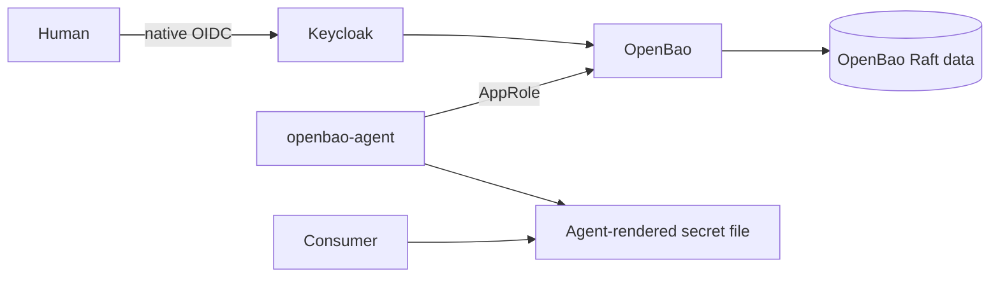

# Security Tier Architecture Description

## Overview

### Purpose and Readers

`03-security` owns machine-secret storage and rendering. OpenBao plus
`openbao-agent` is the HOME implementation; Vault and `vault-agent` were
removed in SPEC-0180 S08. Security operators own seal and unseal custody,
policy, authentication methods, snapshots and migration; consumer tiers own the
least-privilege paths they request. Bootstrap, recovery and backup custody stay
independent of OpenBao so services can be restored without it.

### System Boundary

- **OpenBao:** single-node integrated Raft storage, AppRole Agent rendering,
  native Keycloak OIDC for humans, and a Traefik UI route on
  `gateway-standard-chain@file`.
- **Storage:** Raft snapshots protect stored state; Shamir unseal or recovery
  custody protects access to it.
- **Independent custody:** unseal shares, the CA key and backup recovery
  material follow the current single-administrator policy. Backup and R2
  credentials and account recovery are not ordinary OpenBao consumer
  migrations.
- **Credentials:** root tokens, unseal shares, AppRole RoleID and SecretID,
  Agent tokens, the OIDC client secret and rendered values stay outside Git and
  evidence.
- **Non-goals:** automatic credential generation, a completed Vault-to-OpenBao
  data migration, and multi-node Raft HA.

## Context and Constraints

### Context

Humans authenticate to OpenBao through native Keycloak OIDC; `openbao-agent` authenticates by AppRole and renders secret files that consumer tiers read. Traefik serves the UI route on `gateway-standard-chain@file`.

### Constraints

Credentials (root tokens, unseal shares, AppRole RoleID and SecretID, Agent tokens, the OIDC client secret and rendered values) stay outside Git and evidence. Access fails closed on auth, seal or CA failure, and TLS validation is never disabled. Multi-node Raft HA and automatic credential generation are non-goals.

## Current Structure

### Building Blocks

`openbao-agent` (`infra/03-security/openbao/config/agent.hcl`) reads AppRole
material from mounted secret files, obtains a renewable token and writes the
approved templates to the declared output volume. Its own listener serves only
`/agent/v1/metrics`. Human OIDC group claims map to narrow policies under
`config/policies/`; root is break-glass. The initial and temporary recovery
roots are revoked only after a working non-root administrative path, Agent
rendering, a protected snapshot and denial tests exist.

### Runtime and Deployment

#### Runtime View

An operator or the Agent authenticates, policy limits the KV paths, and the
Agent writes only declared templates to the consumer volume. Snapshots flow
from the authenticated Raft API (`sys/storage/raft/snapshot`, policy
`backup-snapshot.hcl`) to protected operator custody; unseal shares follow a
separate path and never enter a snapshot. The renderer issuer, backup snapshot
token and administrative access have different capabilities, and their source
fixtures keep denial, no-overwrite, publication-race and uncertain-cleanup
checks. A token-operation test is not a deployed credential ceremony, and a
valid Raft snapshot is not an isolated semantic restore.

#### Deployment View

`openbao` and `openbao-agent` (`infra/03-security/openbao/docker-compose.yml`)
are selected by `core`, `dev`, `local`, `security` or `secrets` and join
`secrets_net` and `obs_net`; `openbao` also joins `edge_net`. The root Compose
project owns shared networks, secrets and selection, so leaf-only Compose
execution is not root-stack readiness evidence. The preserved Vault data path
stays out of service and never shares storage with OpenBao. Prometheus declares
an `openbao` scrape job (`infra/06-observability/prometheus/config/prometheus.dev.yml`);
scrape success is not asserted here.

## Interfaces

### Contracts

`openbao-agent` serves only `/agent/v1/metrics` on its own listener. Snapshots use the authenticated Raft API (`sys/storage/raft/snapshot`, policy `backup-snapshot.hcl`); human OIDC group claims map to policies under `config/policies/`; Prometheus declares an `openbao` scrape job.

### Failure Boundaries

Single-node Raft is not HA: an OpenBao outage stops new renders until it is unsealed, and a sealed restart needs independent unseal custody (see Risks below). Recovery uses authenticated Raft snapshots restored on isolated storage; unseal shares never enter a snapshot.

## Decisions

### Decision Links

- [ADR-0050 OpenBao as secrets manager](../decisions/0050-openbao-as-secrets-manager.md)

### Quality and Risks

#### Quality Attributes

- **Security:** fail closed on auth, seal or CA failure; trust the Keycloak CA;
  never disable TLS validation or expose unauthenticated generate-root on the
  ordinary listener.
- **Reliability:** health, unsealed status, Agent authentication, token
  renewal, render output and consumer acceptance are separate evidence.
- **Recoverability:** take authenticated Raft snapshots and rehearse restore on
  isolated new storage with consumers and egress disabled. A snapshot restores
  the token state present at capture, so recovered root tokens must be
  rechecked.
- **Measurement:** REQ-0003's measures separate source render, isolated
  security tests, audit observations and timed recovery; the owning Task
  records the results.

#### Risks

Single-node Raft is not HA: an OpenBao outage stops new renders until it is
unsealed. A sealed restart needs the independent unseal custody.

## Traceability

### Requirement Mapping

- [REQ-0003 Security requirements](../../01.requirements/0003-security.md)

### Currentness and Lineage

- [OpenBao custody policy](../../05.operations/policies/04-security-and-secrets/0085-openbao.md)
- [OpenBao operations](../../05.operations/guides/04-security-and-secrets/0085-openbao.md)
- [Derived Compose image projection](../../../infra/tech-stack.versions.json)

#### Evolution

Cluster expansion needs a separate design with failure-domain evidence.
