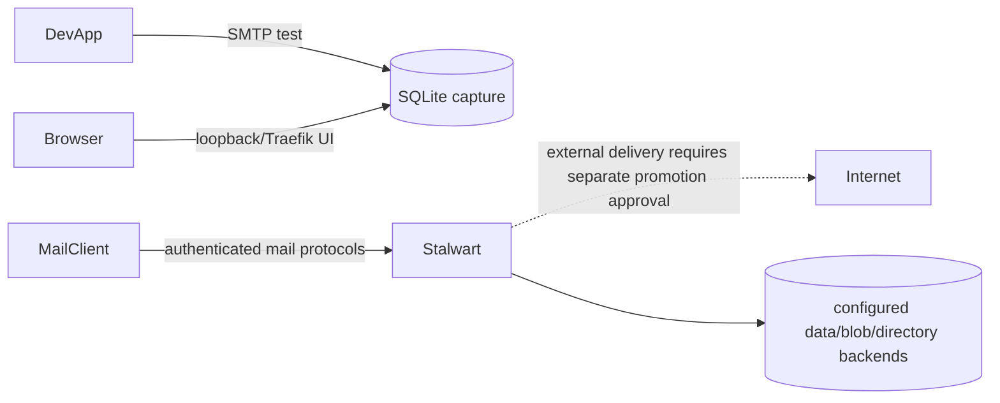

# Communication Tier Architecture Description

## Overview

### Purpose and Readers

The mail requirements separate development message capture in `11-quality/mailpit` from the optional mail server, which since SPEC-0262 is the standalone LAB `labs/stalwart/docker-compose.yml` and joins no HOME network; it is not promoted. Mailpit is a DEV SMTP sink/UI selected by `dev`, `local`, or
`mail-dev`. Stalwart is selected only by the LAB profile `mail-server` and requires mail-domain,
DNS, TLS, authentication, relay, abuse, and backup ownership before use.

### System Boundary

- **Mailpit owns:** test-message capture in persistent SQLite
  `/data/mailpit.db`, loopback-published SMTP/UI ports, and a Traefik UI route.
  It accepts arbitrary SMTP authentication by design and must not be internet
  exposed or described as a delivery MTA.
- **Stalwart owns:** internal SMTP25/submission587, implicit-TLS IMAP993 and HTTP8080 listeners, a management UI, and `${LAB_DATA_DIR}/stalwart/data`. Only HTTP8080 is published, on `${LAB_HOST_BIND_IP:-127.0.0.1}:${LAB_STALWART_HOST_PORT:-18093}`; the mail listeners are reachable only on the LAB network `hy-home-lab-stalwart`. It has no gateway route. Its `stalwart-config` helper reconciles the complete listener set from `config/plan.ndjson`, including relay denial.
- **Declared versus observed:** tracked `config/plan.ndjson` supplies the domain, listeners and relay-denial intent. The actual datastore/backend state, successful plan application, users, DKIM keys and DNS provider state remain unverified. Operators must
  inspect the running configuration without exposing values before choosing a
  backend-specific export or snapshot.
- **Non-goals:** Mailpit does not replace Stalwart, and Stalwart is not an
  automatic HOME service.

## Context and Constraints

### Context

Development applications and browsers reach Mailpit; mail clients reach Stalwart over authenticated mail protocols; external delivery from Stalwart is a separate promotion decision, as the Runtime View diagram shows.

### Constraints

Mailpit must not be internet exposed and no captured development message may be relayed externally. Stalwart requires mail-domain, DNS, TLS, authentication, relay, abuse and backup ownership before use, and public delivery requires DNS/SPF/DKIM/DMARC and TLS promotion acceptance. Runtime pins are owned by Compose/Dockerfile declarations; the
[derived Compose image projection](../../../infra/tech-stack.versions.json) supplies drift verification.

## Current Structure

### Building Blocks

Mailpit is the development SMTP/UI component backed by one SQLite database.
Stalwart is the optional mail-protocol and administration component backed by
the operator-selected storage configuration under its persistent mount.

### Runtime and Deployment

#### Runtime View

#### Deployment View

The root project includes only the Mailpit leaf, selected by `mail-dev`, `dev` or `local`. Stalwart is started from its own LAB entrypoint, where `mail-server` selects Stalwart plus `stalwart-config`. A
currently running optional service may remain running when another profile is
rendered; profile rendering is not a stop operation.

## Interfaces

### Contracts

- Mailpit: SMTP and UI ports published on loopback, plus a Traefik UI route.
- Stalwart: internal SMTP25/submission587 and implicit-TLS IMAP993 listeners on the LAB network `hy-home-lab-stalwart`; HTTP8080 published on `${LAB_HOST_BIND_IP:-127.0.0.1}:${LAB_STALWART_HOST_PORT:-18093}`; no gateway route.

### Failure Boundaries

Mailpit recovery preserves SQLite with its WAL or uses the official dump/ingest path; Stalwart recovery is described under Recoverability in Quality and Risks. Relay denial is reconciled from `config/plan.ndjson`, and a running optional service may stay running when another profile is rendered.

## Decisions

### Decision Links

- [ADR-0054 Mailpit in HOME and Stalwart as a LAB](../decisions/0054-mailpit-home-stalwart-lab.md)

### Quality and Risks

#### Quality Attributes

- **Isolation:** applications choose Mailpit explicitly for tests; no captured
  development message may be relayed externally.
- **Security:** current internal operation needs authenticated protocol and relay-denial evidence. Public delivery additionally requires DNS/SPF/DKIM/DMARC and TLS promotion acceptance. No public listener or internet-delivery success is inferred from current source.
- **Recoverability:** Mailpit recovery preserves SQLite with its WAL or uses the
  official dump/ingest path. Stalwart recovery captures configuration, all active
  storage backends, keys/certificates, and DNS dependencies at one consistency
  point, then restores with outbound delivery disabled.
- **Licensing:** Stalwart upstream offers AGPL-3.0 and enterprise licensing;
  deployment documentation must not assume paid features or entitlement.

## Traceability

### Requirement Mapping

- [Communication requirement](../../01.requirements/0011-communication.md)

### Currentness and Lineage

The description reflects the current tree at its `updated` date and history lives in Git. Operations guides:

- [Mailpit operations](../../05.operations/guides/11-mail-and-notifications/0084-mailpit.md)
- [Stalwart operations](../../05.operations/guides/15-labs/0070-mail.md)
