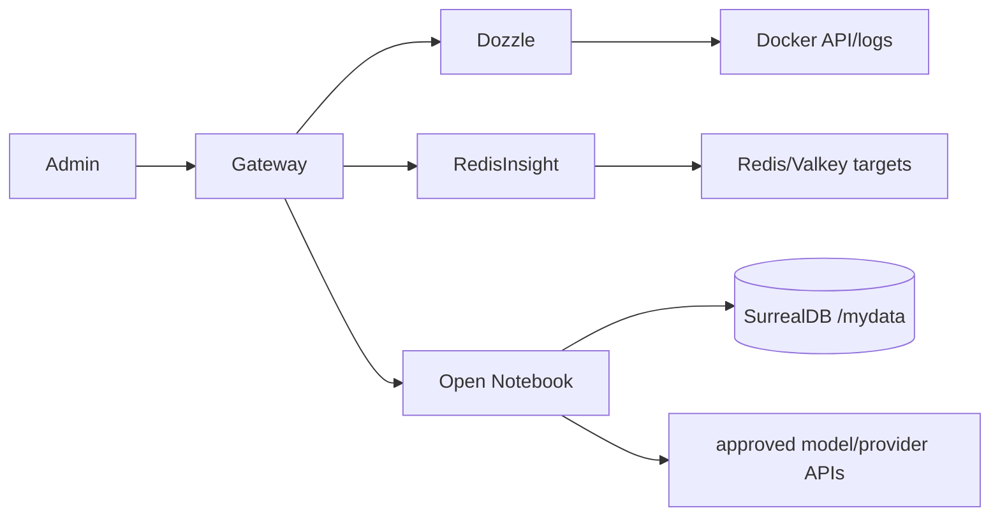

# Administration and Experimentation Architecture Description

## Overview

### Context and Stakeholders

The former Laboratory capabilities now reside in their owning Data, Observability, AI and Analytics tiers; SPEC-0197 moved them there and is retired (its body is in version history). This description records the structure of those operator and knowledge-work services; their obligations are owned by [REQ-0012](../../01.requirements/0012-laboratory.md).

## Scope

### System Boundaries

- **Dozzle:** `admin`/`admin-logs`; reads Docker logs through a read-only socket,
  stores settings under `/data`, and uses both native OIDC configuration and the
  tracked gateway controls. A read-only socket does not restrict Docker API reads.
- **RedisInsight:** `admin`/`admin-data`; stores local connections/settings under
  `/data` and manages external Redis/Valkey targets. Target data remains owned by
  each target service. Current Compose does not declare `RI_ENCRYPTION_KEY`.
- **Open Notebook:** `notebook`; stores local app data under `/app/data`,
  connects to SurrealDB within the same `08-ai/open-notebook` package, and uses password/encryption-key Docker
  Secrets. Provider/API egress is a distinct authorization boundary.
- **SurrealDB:** the nested build in `infra/08-ai/open-notebook/surrealdb`, selected by `notebook` or `surrealdb`, persists Open Notebook records under `/mydata`; its host-port block remains commented out.
- **MLflow:** `08-ai/mlflow` retains tracking and feature-owned DB provisioning under `mlops`/`data-science`; PostgreSQL metadata and SeaweedFS artifacts recover together. The browser uses ForwardAuth, while direct SDK access on all four declared networks lacks equivalent authentication.
- **JupyterLab:** the standalone LAB `labs/jupyterlab/docker-compose.yml` (SPEC-0262), selected by its `jupyterlab` LAB profile, retains its token-file startup guard and UID1000 notebook workspace under the LAB data root. It has no gateway route and is published only on the LAB bind address.
- **Non-goals:** this tier does not own primary Redis/Valkey backups, copied Docker
  logs, production notebook workloads, or Metabase. No current Metabase service is
  declared in this tier.

### Traceability

- [Dozzle operations](../../05.operations/guides/07-observability/0072-dozzle.md)
- [Open Notebook operations](../../05.operations/guides/09-ai-and-search/0073-open-notebook.md)
- [RedisInsight operations](../../05.operations/guides/05-databases-and-storage/0076-redisinsight.md)
- Retired ADR-0011 (number reserved in the Registry; body in version history)
  selected Homer, Portainer, RedisInsight, Dozzle and Open Notebook with SurrealDB
  for the former `11-laboratory` tier, and recorded that the Docker socket
  exposure needs SSO access control. It was deprecated on 2026-10-29 when
  SPEC-0197 removed that tier and deleted on 2026-11-04. RedisInsight, Dozzle and
  Open Notebook with SurrealDB remain current under this description; Homer and
  Portainer have no current service.

## Structure

### Components

## Runtime and Deployment

### Data Flow

Dozzle requests Docker log streams, RedisInsight opens operator-defined target
connections, and Open Notebook sends approved provider requests while persisting
application records in SurrealDB. These flows are independent; selecting one
narrow profile must not grant another tool's target or API access.

### Deployment View

The root project includes five package leaves across four tiers and seven service identities. `admin` selects Dozzle and RedisInsight; `admin-logs`/`admin-data` select each separately. `notebook` selects Open Notebook and nested SurrealDB, `surrealdb` only that DB. `mlops` and `data-science` select MLflow and its provisioner; JupyterLab left the root for a LAB entrypoint. Dozzle is a separate Observability leaf, not an entry in the aggregate Compose file. Profiles, host paths and service identities remain unchanged.

## Quality and Risks

### Quality Attributes

- **Security:** preserve gateway/allowlist/authentication controls, protect local
  settings databases, and never expose provider credentials, target passwords,
  logs, notebook content, or encryption keys in evidence.
- **Recoverability:** Dozzle settings can be restored without a production Docker
  socket. RedisInsight local settings and each target database recover separately.
  Open Notebook recovery requires app data, SurrealDB data, and the matching
  encryption key at one recovery point; loss of the key can make provider secrets
  unreadable.
- **Isolation:** restore rehearsals block provider egress, production Docker API,
  and production data targets until sanitized acceptance passes.

## Related Documents

- [Laboratory requirement](../../01.requirements/0012-laboratory.md)

Runtime pins are owned by Compose/Dockerfile declarations; the
[derived Compose image projection](../../../infra/tech-stack.versions.json) supplies drift verification.
