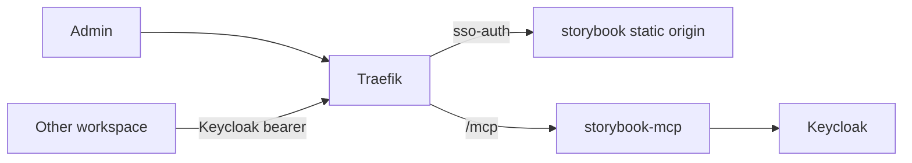

# Experience Tier Architecture Description

## Overview

### Purpose and Readers

The `13-experience` tier owns the shared Storybook delivery: a static
documentation origin and a remote docs MCP, both built from one commit of
`projects/storybook/nextjs`. Stakeholders are UI developers, design reviewers
and infrastructure operators. The tier is optional and outside the default HOME
selection.

### System Boundary

- **storybook:** an unprivileged, read-only static origin on the internal
  `experience_ingress_net`, with no secret, persistent volume or host port.
  Traefik serves `storybook.${DEFAULT_URL}` behind `req-rate-limit`,
  `gateway-standard-chain` and `sso-auth`.
- **storybook-mcp:** a read-only remote docs MCP on `edge_net` that serves the
  manifests of the same build. It accepts only Keycloak bearer tokens for its
  own URL from the `/admins` group; Traefik forwards only `/mcp` and the
  protected-resource metadata path, and no cookie-based `sso-auth` applies.
- **Selection:** both services use the `experience` profile and carry the
  `hy-home.tier: experience` label.
- **Non-goals:** component code, stories and the static build belong to
  `projects/storybook/nextjs`; this tier owns no business application, and
  Compose validation proves no running service, login or HOME activation.

## Context and Constraints

### Context

UI developers and design reviewers reach Storybook through Traefik with `sso-auth`, while other workspaces call `storybook-mcp` with a Keycloak bearer token. The tier depends on Keycloak and the `projects/storybook/nextjs` build.

### Constraints

The tier is optional and outside the default HOME selection. Both images are pinned to one commit, the static origin serves only administrators, the MCP authorizes by token alone, and static validation infers no runtime, TLS or browser result.

## Current Structure

### Building Blocks

### Runtime and Deployment

#### Runtime View

Administrators reach the static origin after the gateway and ForwardAuth
checks. Other workspaces call `storybook-mcp` with a Keycloak token; the server
verifies the signature, issuer, audience, lifetime and group before it returns
`docs-list`, `docs-show` or `docs-show-story` results.

#### Deployment View

The root Compose project includes the `infra/13-experience/storybook` leaf.
Both images are pinned to the same commit with `pull_policy: never`, so a
missing image fails the start. The `experience` profile is selected only on
request.

## Interfaces

### Contracts

- `storybook.${DEFAULT_URL}` is served through `req-rate-limit`, `gateway-standard-chain` and `sso-auth`.
- `storybook-mcp` serves `docs-list`, `docs-show` and `docs-show-story` on `/mcp` and the protected-resource metadata path, for Keycloak bearer tokens from the `/admins` group.
- Both services use the `experience` profile.

### Failure Boundaries

Both images use `pull_policy: never`, so a missing image fails the start. The MCP rejects a token with the wrong signature, issuer, audience, lifetime or group, and no cookie-based `sso-auth` applies to the MCP.

## Decisions

### Decision Links

No ADR is linked to this description. POL-0101 and its operations documents, linked under Currentness and Lineage, define the contracts.

### Quality and Risks

#### Quality Attributes

Delivery is reproducible from one commit. The static origin serves content only
to administrators, and the MCP authorizes by token alone. Static validation
infers no runtime, TLS or browser result.

#### Risks

A build whose commit differs between the two images, or a token accepted for
another audience, would break the contracts that POL-0101 defines.

## Traceability

### Requirement Mapping

- [REQ-0027](../../01.requirements/0027-home-development-host.md)

### Currentness and Lineage

- SPEC-0219 (retired; version history)
- [Storybook guide](../../05.operations/guides/14-design-system/0101-storybook.md)
- [Storybook policy](../../05.operations/policies/14-design-system/0101-storybook.md)
- [Storybook runbook](../../05.operations/runbooks/14-design-system/0101-storybook.md)
- [Experience tier packages](../../../infra/13-experience/README.md)
- [AD-0031](0031-home-development-host.md)

#### Evolution

Changes to the build, routes or token checks follow POL-0101 and its
operations documents; this description changes only when the structure does.
