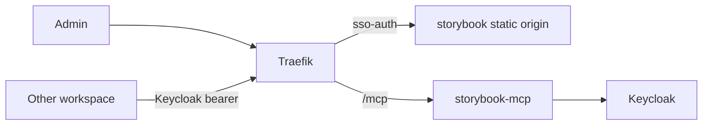

# Experience Tier Architecture Description

## Overview

The `13-experience` tier owns the shared Storybook delivery: a static
documentation origin and a remote docs MCP, both built from one commit of
`projects/storybook/nextjs`. Stakeholders are UI developers, design reviewers
and infrastructure operators. The tier is optional and outside the default HOME
selection.

## Scope

### System Boundaries

- **storybook:** an unprivileged, read-only static origin on the internal
  `experience_ingress_net`, with no secret, persistent volume or host port.
  Traefik serves `storybook.${DEFAULT_URL}` behind `req-rate-limit`,
  `gateway-standard-chain` and `sso-auth`.
- **storybook-mcp:** a read-only remote docs MCP on `edge_net` that serves the
  manifests of the same build. It accepts only Keycloak bearer tokens for its
  own URL from the `/admins` group; Traefik forwards only `/mcp` and the
  protected-resource metadata path, and no cookie-based `sso-auth` applies.
- **Selection:** both services use the `experience` profile and carry the
  `hy-home.tier: experience` label.
- **Non-goals:** component code, stories and the static build belong to
  `projects/storybook/nextjs`; this tier owns no business application, and
  Compose validation proves no running service, login or HOME activation.

### Traceability

- [SPEC-0219](../../03.specs/0219-storybook-build-and-delivery/spec.md)
- [Storybook guide](../../05.operations/guides/14-design-system/0101-storybook.md)
- [Storybook policy](../../05.operations/policies/14-design-system/0101-storybook.md)
- [Storybook runbook](../../05.operations/runbooks/14-design-system/0101-storybook.md)

## Structure

### Components

## Runtime and Deployment

### Runtime View

Administrators reach the static origin after the gateway and ForwardAuth
checks. Other workspaces call `storybook-mcp` with a Keycloak token; the server
verifies the signature, issuer, audience, lifetime and group before it returns
`docs-list`, `docs-show` or `docs-show-story` results.

### Deployment View

The root Compose project includes the `infra/13-experience/storybook` leaf.
Both images are pinned to the same commit with `pull_policy: never`, so a
missing image fails the start. The `experience` profile is selected only on
request.

## Quality and Risks

### Quality Attributes

Delivery is reproducible from one commit. The static origin serves content only
to administrators, and the MCP authorizes by token alone. Static validation
infers no runtime, TLS or browser result.

### Risks

A build whose commit differs between the two images, or a token accepted for
another audience, would break the contracts that SPEC-0219 defines.

### Evolution

Changes to the build, routes or token checks follow SPEC-0219 and its
operations documents; this description changes only when the structure does.

## Related Documents

- [REQ-0027](../../01.requirements/0027-home-development-host.md)
- [Experience tier packages](../../../infra/13-experience/README.md)
- [AD-0031](0031-home-development-host.md)
